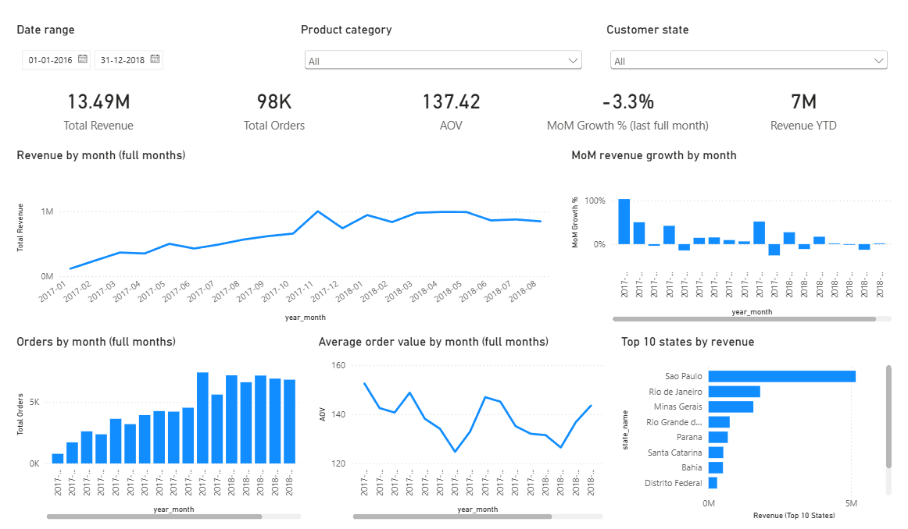
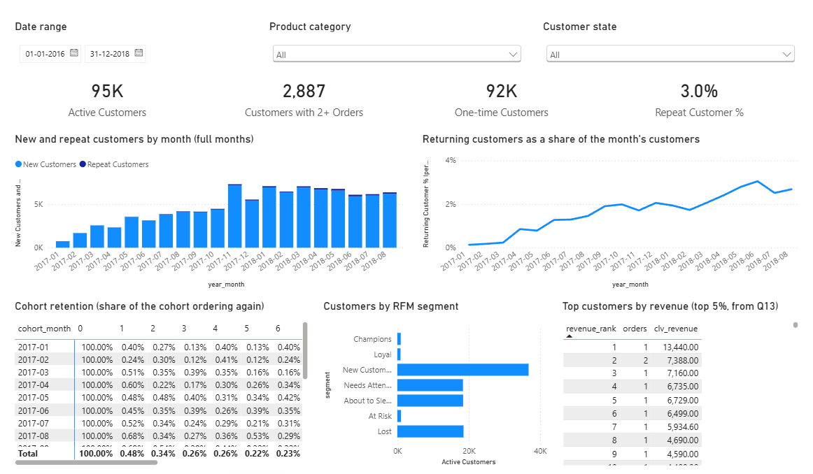
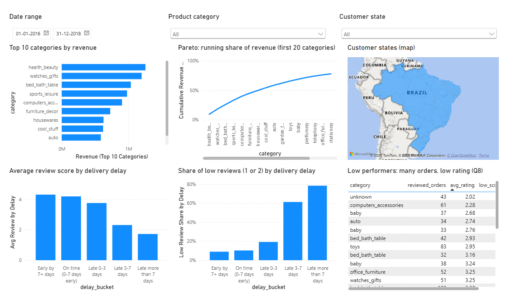
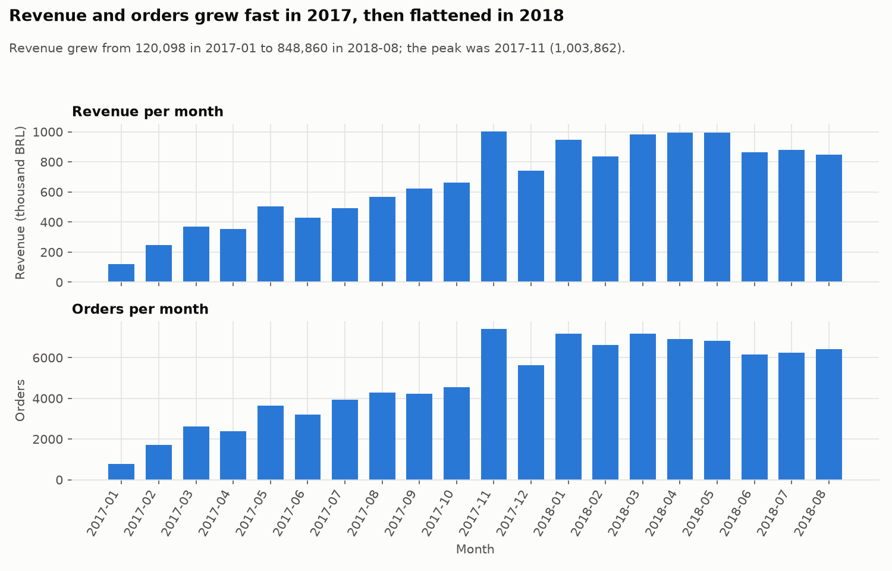
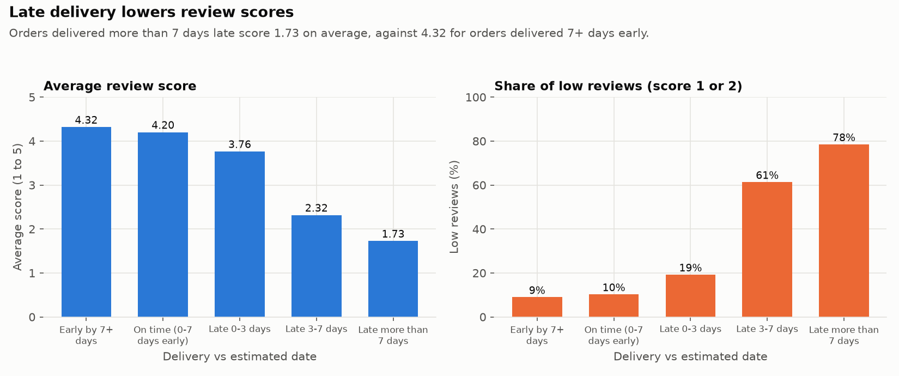
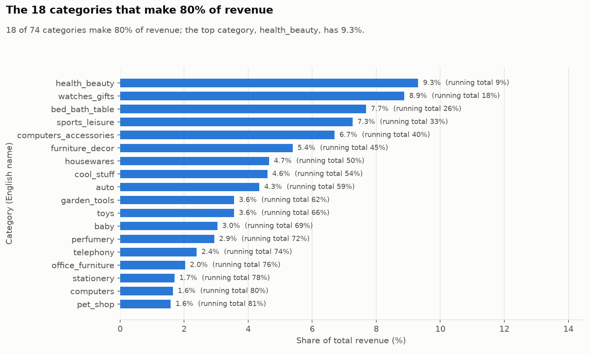
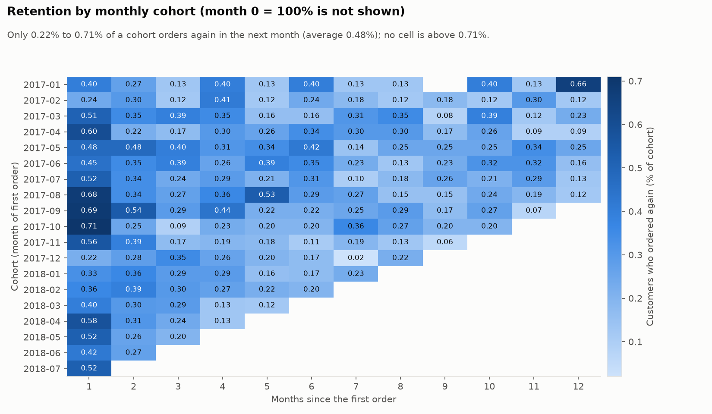
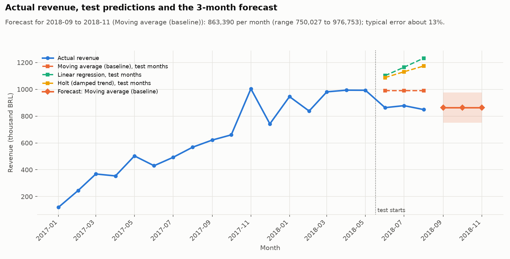
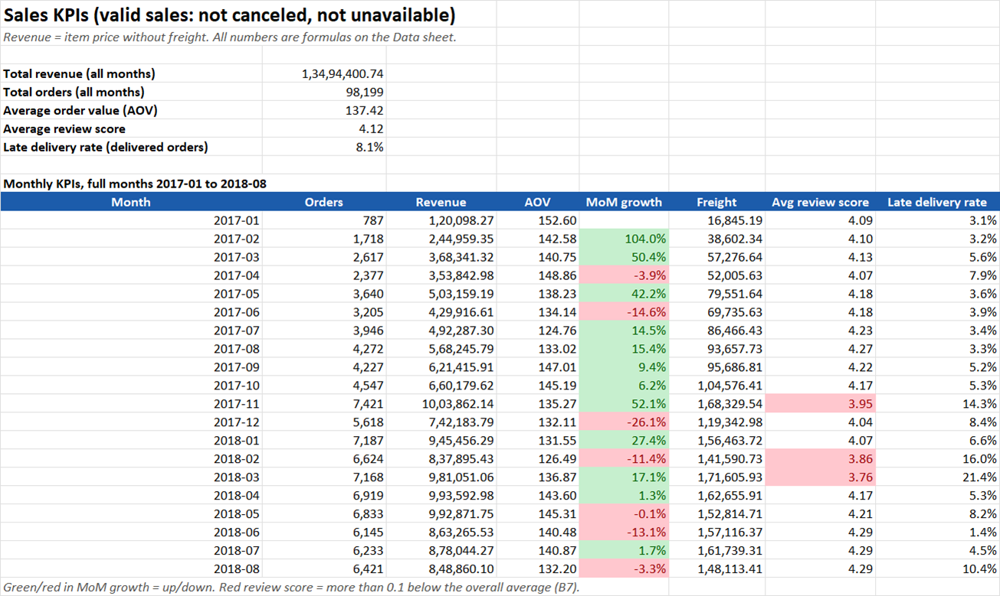
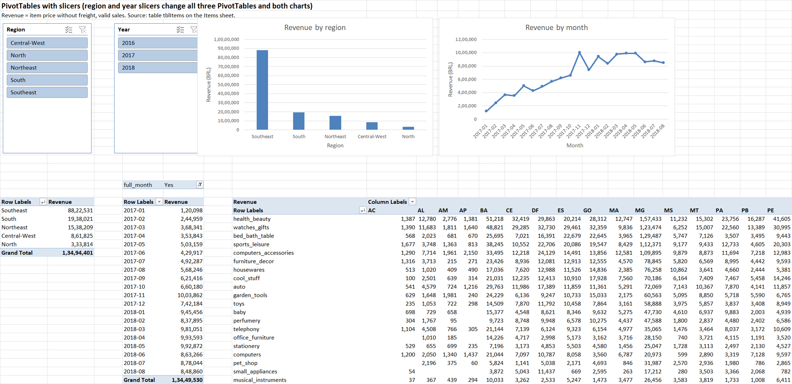

# Ecommerce_Sales_Analytics

**An end-to-end data analyst project on about 100,000 real e-commerce orders: pipeline, cleaning, SQL, statistics, forecast, Excel, Power BI and a manager report.**

**Business question:** where does the marketplace grow, who buys, and what hurts customer satisfaction?
Answer in one line: revenue grew fast in 2017 and then flattened, almost nobody buys twice (3.04% of customers),
and late deliveries are the biggest driver of bad reviews (54.1% low reviews for late orders vs 9.2% for on-time orders).

**Read the 2-page summary for managers: [reports/insights_report.pdf](reports/insights_report.pdf).**

| Power BI dashboard (3 pages) | |
|---|---|
|  |  |
|  | |

## Part 2 of my e-commerce data project

This repository is the analysis part. The data engineering part is my pipeline repository
**[Enterprise_Data_Analysis](https://github.com/Vaibhavpisute/Enterprise_Data_Analysis)** (PostgreSQL, PySpark, MinIO and Hive in Docker).
The Olist data went through that pipeline first, and then I analysed its output:

```
Olist CSV files
   -> PostgreSQL (olist_db)                                   pipeline_ingest/01_load_olist_to_postgres.py
   -> PySpark job: cast types, remove duplicates, join        pipeline_ingest/02_olist_spark_job.py (runs in the pipeline's Airflow container)
   -> Parquet in MinIO + Hive tables (database "olist")
   -> export to data/raw/pipeline_output/                     pipeline_ingest/03_export_from_minio.py
   -> cleaning with pandas, star schema in PostgreSQL         notebooks/01_data_cleaning.ipynb  (analytics_db)
   -> 15 SQL queries                                          sql/
   -> EDA, statistics, A/B test (simulated), forecast         notebooks/02 to 04
   -> Excel report and Power BI dashboard                     excel/, powerbi/
   -> insights report (PDF)                                   reports/insights_report.pdf
```

## Tools used

PostgreSQL 16, PySpark 3.5 (local mode), MinIO, Hive, Apache Airflow and Docker (from the pipeline) | Python 3.12 with pandas, NumPy, SciPy,
statsmodels, scikit-learn, matplotlib, SQLAlchemy, openpyxl, pywin32, reportlab | SQL (window functions, CTEs, cohort and RFM logic) |
Microsoft Excel (formulas, XLOOKUP, Power Query, PivotTables, slicers) | Power BI Desktop (TMDL model, DAX, PBIR report) | Git.

## Key insights

All numbers come from the SQL results and the notebooks in this repository.
Revenue means item price without freight, for valid sales (not canceled or unavailable).

1. **Growth slowed in 2018.** Monthly revenue rose from 120,098 (2017-01) to 848,860 (2018-08); the peak was 2017-11 (1,003,862). Average monthly growth fell from 22.7% in 2017 to 2.5% in 2018.
2. **Almost nobody comes back.** Only 2,887 of 94,983 customers (3.04%) bought more than once. On average 0.48% of a monthly cohort orders again in the next month. 98.2% of revenue comes from customers in their first month.
3. **Late delivery destroys reviews.** 8.0% of delivered orders arrive late. 54.1% of late orders get a 1 or 2 star review, against 9.2% of on-time orders (average score 2.56 vs 4.29). A late order is 5.9 times as likely to get a low review (statistical test: p below 0.05, effect size d = 1.45, large).
4. **A few categories carry the business.** 18 of 74 categories make 80% of revenue. The top 3 (health beauty, watches gifts, bed bath table) make 25.9%. Products without a category name make 1.3% of revenue.
5. **Revenue sits in the Southeast.** SP, RJ, MG make 63.4% of revenue; SP alone makes 38.3%.
6. **People buy on weekdays, during work hours.** 45.2% of orders are placed between 10:00 and 16:59, and only 23.0% on a weekend (Monday is the busiest day, Saturday the quietest).

| | |
|---|---|
|  |  |
|  |  |

### Recommendations

1. **Fix delivery first** (finding 3). Reduce late deliveries and make delivery dates honest: watch the slowest carriers and lanes, add safety days to risky estimates, and warn customers early. Track the late rate (today 8.0%) and the share of 1 and 2 star reviews every month.
2. **Start a retention programme** (finding 2). Send a follow-up message after delivery and a second-order offer. Start with the 36,753 recent first-time buyers (segment "New Customers") and the 2,887 repeat buyers in the segments Champions, Loyal and At Risk.
3. **Focus range and marketing on the top categories** (finding 4). Put stock, seller recruitment and advertising budget behind the 18 categories that make 80% of revenue. Fix the missing category names (1.3% of revenue) so that reports are complete.
4. **Test free shipping with a real A/B test** (finding 1, 5). Freight is 16.6% of the item value, so free shipping is expensive. Run a proper test before any roll-out. The method demo in this project (SIMULATED data, not real customers) shows that about 19,716 visitors per group are needed to detect a +0.5 point gain on a 3.0% conversion rate.
5. **Run promotions and support on weekdays** (finding 6). Plan promotions, e-mail sends and customer support hours for weekdays between 10:00 and 17:00, when most orders arrive.

## The 15 SQL queries

Each file starts with the business question, the approach and where it is used later. Results are in `sql/outputs/`.
`sql/check_sql_vs_pandas.py` compares Q1 and five other queries with pandas (all checks match).

| # | Query | Main SQL skill | Result |
|---|---|---|---|
| 1 | [Data quality check](sql/q01_data_quality_check.sql) | COUNT, LEFT JOIN ... IS NULL | [csv](sql/outputs/q01_data_quality_check.csv) |
| 2 | [Monthly revenue, orders and AOV](sql/q02_monthly_revenue_orders_aov.sql) | DATE / GROUP BY | [csv](sql/outputs/q02_monthly_revenue_orders_aov.csv) |
| 3 | [Month-over-month growth %](sql/q03_mom_growth.sql) | LAG() | [csv](sql/outputs/q03_mom_growth.csv) |
| 4 | [Running total and 3-month moving average](sql/q04_running_total_moving_avg.sql) | SUM() OVER, AVG() OVER (ROWS ...) | [csv](sql/outputs/q04_running_total_moving_avg.csv) |
| 5 | [Revenue by weekday and hour](sql/q05_revenue_by_weekday_hour.sql) | EXTRACT, GROUP BY | [csv](sql/outputs/q05_revenue_by_weekday_hour.csv) |
| 6 | [Top 10 products per category](sql/q06_top10_products_per_category.sql) | DENSE_RANK() OVER (PARTITION BY) | [csv](sql/outputs/q06_top10_products_per_category.csv) |
| 7 | [Category share and Pareto 80/20](sql/q07_category_share_pareto.sql) | SUM() OVER (), running % | [csv](sql/outputs/q07_category_share_pareto.csv) |
| 8 | [Low performers: many orders, low rating](sql/q08_low_performers.sql) | CTE, JOIN, HAVING | [csv](sql/outputs/q08_low_performers.csv) |
| 9 | [New vs repeat customers per month](sql/q09_new_vs_repeat_customers.sql) | CTE, MIN() OVER (PARTITION BY) | [csv](sql/outputs/q09_new_vs_repeat_customers.csv) |
| 10 | [Repeat-purchase rate and days between orders](sql/q10_repeat_rate_days_between.sql) | LEAD(), date difference | [csv](sql/outputs/q10_repeat_rate_days_between.csv) |
| 11 | [Monthly cohort retention](sql/q11_cohort_retention.sql) | multiple CTEs, cohort logic | [csv](sql/outputs/q11_cohort_retention.csv) |
| 12 | [RFM scores and segments](sql/q12_rfm_segments.sql) | NTILE(5), CASE WHEN | [csv](sql/outputs/q12_rfm_segments.csv) |
| 13 | [Customer lifetime value and top 5%](sql/q13_customer_lifetime_value_top5.sql) | PERCENT_RANK() | [csv](sql/outputs/q13_customer_lifetime_value_top5.csv) |
| 14 | [Delivery delay vs review score](sql/q14_delivery_delay_vs_review.sql) | CASE WHEN buckets, AVG | [csv](sql/outputs/q14_delivery_delay_vs_review.csv) |
| 15 | [Order value by payment type and region](sql/q15_order_value_by_payment_and_region.sql) | GROUPING SETS / ROLLUP | [csv](sql/outputs/q15_order_value_by_payment_and_region.csv) |

## Statistics and A/B test

Details, assumptions and conclusions are in [notebooks/03_statistics_ab_test.ipynb](notebooks/03_statistics_ab_test.ipynb).
All tests use alpha = 0.05 and report an effect size, because with about 100,000 orders almost every difference is "significant".

| Test | Data | Result |
|---|---|---|
| Welch t-test: review score, on-time vs late | real | On-time orders score 1.73 points higher (4.29 vs 2.56), 95% CI 1.69 to 1.77, Cohen's d = 1.45 (large) |
| ANOVA and Kruskal-Wallis: order value by payment type | real | Assumptions fail (skewed data), Kruskal-Wallis is used. Types differ, but the effect is very small (eta squared 0.0032) |
| Chi-square: RFM segment vs region | real | Significant, but Cramer's V = 0.022 (very small): region does not predict the segment |
| Probabilities | real | P(customer buys again) = 3.04%. P(low review given late) = 54.11% vs 9.22% when on time (risk ratio 5.87) |
| **A/B test: free vs paid shipping** | **SIMULATED** | **SIMULATED data, not real customers** (fixed seed 42, assumed base rate 3.0%). Needs 19,716 visitors per group for a +0.5 point effect. Simulated result: 2.90% vs 3.57%, lift 23.3%, p = 0.00015. Design check with 5,000 repeated simulated experiments: power 80.7%, false positives 5.1% |

## Forecast

[notebooks/04_forecast.ipynb](notebooks/04_forecast.ipynb) forecasts monthly revenue for the 3 months after the data
(2018-09 to 2018-11). It uses the 20 full months (2017-01 to 2018-08).
A time-based split (last 3 months as test) and a rolling backtest compare a 3-month moving average, a linear regression (trend and month pattern) and Holt smoothing.
**Result:** the simple moving average wins (rolling backtest MAPE 13.1%, against 23.2% for regression
and 14.5% for Holt), because growth was flat in 2018. Forecast: about 863,390 per month
(range 750,062 to 976,718). It is a method demo: short history, no holiday information.



## Excel report and Power BI dashboard

- **Excel:** [excel/sales_report.xlsx](excel/sales_report.xlsx): KPIs with real formulas and conditional formatting, RFM segments with XLOOKUP,
  Power Query queries (the data folder is the named cell `DataFolder`), PivotTables with slicers, PivotCharts. Built and checked with Excel automation,
  see [excel/EXCEL_STEPS.md](excel/EXCEL_STEPS.md).
- **Power BI:** [powerbi/EcommerceSales.pbip](powerbi/EcommerceSales.pbip): a Power BI Project (TMDL model with a date table, 7 relationships and 28 DAX measures, PBIR report with 3 pages).
  The saved file [powerbi/dashboard.pbix](powerbi/dashboard.pbix) (6.4 MB, data included) opens directly. The model CSV files (`powerbi/data/`) are not in git. See [powerbi/POWERBI_STEPS.md](powerbi/POWERBI_STEPS.md) to regenerate it, refresh and check the numbers. DAX list: [powerbi/DAX_MEASURES.md](powerbi/DAX_MEASURES.md).

| | |
|---|---|
|  |  |

## Limits

- Period and scope. One marketplace, valid sales from 2016-09 to 2018-09. Trends use the full months 2017-01 to 2018-08 only.
- Patterns, not proof. The data shows links (for example late delivery and low reviews), not causes.
- The A/B test is SIMULATED. It uses made-up data with a fixed random seed. It shows the method, not a real result.
- Forecast. Only 20 full months, no holiday information, and the 3 forecast months are after the end of the data.
- No costs. Revenue is the item price without freight. Margin and profit are unknown.

## Data source and credit

**Brazilian E-Commerce Public Dataset by Olist** ([Kaggle](https://www.kaggle.com/datasets/olistbr/brazilian-ecommerce)). Real, anonymised orders (2016 to 2018).
Credit: Olist, who released the dataset. Licence: **CC BY-NC-SA 4.0** (non-commercial use, share alike, give credit), so this project is for learning and portfolio use.
More details and row counts: [data/DATA_SOURCE.md](data/DATA_SOURCE.md). The A/B test in this project is simulated and is always labelled SIMULATED.

## How to run

Needs: Windows, Docker Desktop, Python 3.12, a Kaggle account (for the download). Excel and Power BI Desktop are only needed for the last two steps.

1. **Set up Python:** `py -3.12 -m venv .venv`, then `.venv\Scripts\pip install -r requirements.txt`.
2. **Settings:** copy `.env.example` to `.env` and fill in the values (PostgreSQL and MinIO of the pipeline's Docker containers). `.env` is never committed.
3. **Start the pipeline containers** (project `sales-demo` of the pipeline repository): `docker compose up -d` in its `local_demo` folder.
4. **Get the data through the pipeline:** put your Kaggle token in `C:\Users\<you>\.kaggle\kaggle.json`, then follow [pipeline_ingest/README.md](pipeline_ingest/README.md)
   (download, load into PostgreSQL, run the Spark job, export from MinIO).
5. **Clean and load the star schema:** run `notebooks/01_data_cleaning.ipynb` (creates `data/processed/` and fills `analytics_db`).
6. **SQL:** `.venv\Scripts\python sql\run_all_queries.py`, then `.venv\Scripts\python sql\check_sql_vs_pandas.py`.
7. **Notebooks** (02, 03, 04): `.venv\Scripts\jupyter nbconvert --to notebook --execute --inplace notebooks\<name>.ipynb` for each notebook.
   They also write `reports/eda_results.json`, `reports/stats_results.json` and `reports/forecast_results.json`.
8. **Excel:** `python excel\build_workbook.py`, `python excel\add_excel_features.py`, `python excel\check_and_export.py` (see `excel/EXCEL_STEPS.md`).
9. **Power BI:** `python powerbi\export_model_data.py`, then open `powerbi\EcommerceSales.pbip` (see `powerbi/POWERBI_STEPS.md`).
10. **Report and README:** `python reports\build_insights_report.py`, then `python reports\build_readme.py`.
11. **Checks before publishing:** `python reports\check_numbers.py` recomputes every number of this README and of the PDF (needs the PostgreSQL container) and writes
    `reports/number_check.md`.
12. Stop the containers: `docker compose stop`.

`requirements.txt` includes `pywin32`, which is only needed (and only installs) on Windows, for the Excel automation.

## License

- **Code:** [MIT License](LICENSE), copyright (c) 2026 Vaibhav Pisute.
- **Data:** the Olist dataset is licensed under [CC BY-NC-SA 4.0](https://creativecommons.org/licenses/by-nc-sa/4.0/).
  Files in this repository that contain or are derived from it (the Excel and Power BI files, the SQL result files, the result tables,
  the screenshots and the PDF report) are shared under the same licence: **non-commercial use only, credit Olist, share alike.**
  Details are in [NOTICE](NOTICE). The raw dataset is not included: download it from Kaggle.

## Folder structure

```
Ecommerce_Sales_Analytics/
|-- pipeline_ingest/   Olist load, PySpark job, export from MinIO, run steps
|-- data/              DATA_SOURCE.md (raw and processed data are not committed)
|-- sql/               q01 to q15 queries, run_all_queries.py, check_sql_vs_pandas.py, outputs/ (results as CSV)
|-- notebooks/         01_data_cleaning, 02_eda, 03_statistics_ab_test, 04_forecast (all executed)
|-- src/               db.py, plots.py, helpers.py
|-- excel/             sales_report.xlsx, build and check scripts, EXCEL_STEPS.md
|-- powerbi/           EcommerceSales.pbip (TMDL + PBIR), DAX_MEASURES.md, POWERBI_STEPS.md, theme.json, export and build scripts
|-- screenshots/       charts, Excel and Power BI images used in this README
|-- reports/           insights_report.pdf, result files (json, csv), scripts that build the report and this README
`-- requirements.txt
```
